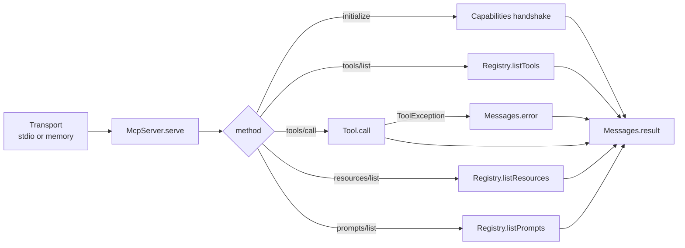

<p align="center">
  <em>Model Context Protocol servers in plain Java. Tools, resources, prompts, two transports, no dependencies.</em>
</p>

<p align="center">
  
  
  
</p>

---

MCP is JSON-RPC over stdio with a capability handshake. Atlas implements the
protocol on the JDK alone — a registry of tools, resources and prompts, plus two
transports so you can drive the server from a test instead of a subprocess.

## Quick start

```java
Registry registry = new Registry();
registry.register(CalculatorTool.create());

McpServer server = new McpServer(registry, "my-server", "1.0.0");
server.serve(StdioTransport.system());
```

Registering a tool directly:

```java
registry.register(new Tool(
    "add",                                    // name
    "Add two integers",                       // description
    Map.of("type", "object",                  // JSON Schema for the arguments
           "properties", Map.of(
               "a", Map.of("type", "number"),
               "b", Map.of("type", "number")),
           "required", List.of("a", "b")),
    args -> List.of(Content.text(String.valueOf(
        ((Number) args.get("a")).doubleValue()
      + ((Number) args.get("b")).doubleValue())))
));
```

```bash
javac -d build/main src/atlas/*/*.java
java -cp build/main atlas.examples.Demo           # scripted, in-memory
java -cp build/main atlas.examples.Demo --stdio   # real stdio server
```

The scripted demo plays a full conversation over `InMemoryTransport` — handshake,
`tools/list`, `tools/call` — so you can read the wire format without wiring up a
client.

## What is in the box

| Package | Contents |
|---|---|
| `atlas.protocol` | `Tool` · `Resource` · `Prompt` · `Content` · `Messages` · `Schemas` · `Capabilities` |
| `atlas.registry` | `Registry` — `register` · `listTools` · `getTool` |
| `atlas.server` | `McpServer` — `serve(Transport)` · `getRegistry()` |
| `atlas.transport` | `StdioTransport` · `InMemoryTransport` · `Transport` |
| `atlas.json` | The hand-written JSON parser everything else depends on |
| `atlas.examples` | `Demo` plus four sample tools |

## Request path



`Tool.call` returns `List<Content>`; a `ToolException` becomes an error response, so
one misbehaving tool does not take the server down.

## Install

Plain Java source — copy `src/atlas` into your module. No build tool, no classpath
additions.

## Tests

```bash
javac -cp "build/main:junit-standalone.jar" -d build/test src/test/atlas/*.java
java -cp "build/main:build/test:junit-standalone.jar" org.junit.platform.console.ConsoleLauncher --scan-class-path
```

28 JUnit 5 cases covering JSON parsing, registry lookup, and the dispatch loop.

## Limitations

- **stdio only.** No HTTP/SSE transport, so one process serves one client.
- **The JSON parser is hand-written and unfuzzed.** It handles the shapes MCP
  needs; do not point it at large untrusted payloads.
- **Single-threaded dispatch.** A slow tool blocks the next request.
- **Input schemas are hand-written JSON Schema**, not inferred from types — more
  verbose, but unambiguous.
- **No benchmark numbers.** None were measured, so none are claimed.

## License

MIT
